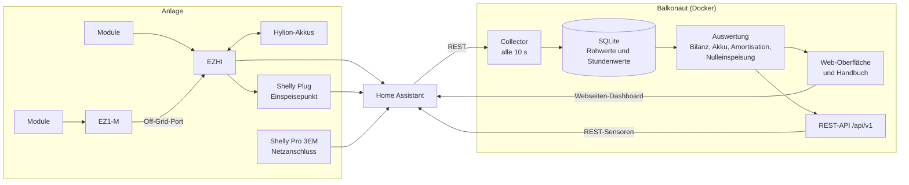

# Balkonaut

**Antworten statt Rohdaten für dein Balkonkraftwerk mit Speicher.**

Das Energy-Dashboard von Home Assistant zeigt, wie viel Strom geflossen ist. Balkonaut beantwortet die
Fragen dahinter: Wie viel spare ich wirklich? Wann hat sich die Anlage bezahlt gemacht? Arbeitet der Akku
gut, und würde ein größerer etwas bringen?

## Was Balkonaut heute kann

- **Bilanz** für heute, Monat, Jahr und gesamt: Erzeugung, Eigenverbrauch, Netzbezug, Einspeisung,
  Autarkiegrad und Ersparnis in Euro
- **Amortisation** mit Datum, ab dem sich die Anlage voraussichtlich bezahlt gemacht hat
- **Akku-Auswertung**: Vollzyklen, Gesundheit, Wirkungsgrad, Stunden mit vollem oder leerem Akku
- **Saubere Messwerte**: feste Regeln, welche Quelle für welche Größe zählt (z. B. über alle Phasen
  saldierter Netzbezug statt der Phasenzähler eines Shelly Pro 3EM)
- **Verlauf übernehmen**: die letzten Tage aus Home Assistant einmalig importieren
- Läuft als **Docker-Container** (z. B. auf einer NAS), liest die Daten über Home Assistant,
  Handbuch auf Deutsch eingebaut

Entwickelt und getestet mit APsystems EZHI und EZ1-M, Hylion-Akkus und Shelly Pro 3EM.
Andere Geräte funktionieren, sobald sie als Entitäten in Home Assistant vorhanden sind.

## Aufbau



Die Logik steckt im Python-Paket `core/` ohne Abhängigkeit zu Home Assistant oder Web. Die Docker-App ist eine
dünne Hülle darum, später kommen HACS-Integration und Add-on als weitere Hüllen dazu.

## Schnellstart

```bash
cp config.example.yaml data/config.yaml   # HA-Adresse, Token und Entitäten eintragen
docker compose up -d --build
```

Danach `http://<adresse>:8000/` öffnen. Details stehen im Handbuch unter `/handbuch/`.

## Pläne

| Phase | Inhalt | Stand |
|---|---|---|
| P0 Fundament | Gerüst, Datenquellen, erste Messdaten | erledigt |
| P1 MVP | Erfassung, Bilanz, Amortisation, Dashboard, Container | Testbetrieb |
| P2 Akku & Tiefe | Akku-Auswertung, Regelgüte der Nulleinspeisung, Verlaufsansichten, REST-API | erledigt |
| P3 Simulation & Prognose | Was-wäre-wenn (zweiter Akku, mehr Module, anderer Tarif), PV-Prognose, Monatsbericht | geplant |
| P4 Home Assistant | HACS-Integration mit Sensoren, öffentliches Repository | geplant |
| P5 Öffnen für andere | direkte Geräte-Anbindung ohne HA, weitere Hersteller, Add-on, Lovelace-Card mit Energiefluss | geplant |
| P6 Community | anonymer Vergleich nach Region, dynamische Tarife | Idee |

## Lizenz

[Apache-2.0](LICENSE)
